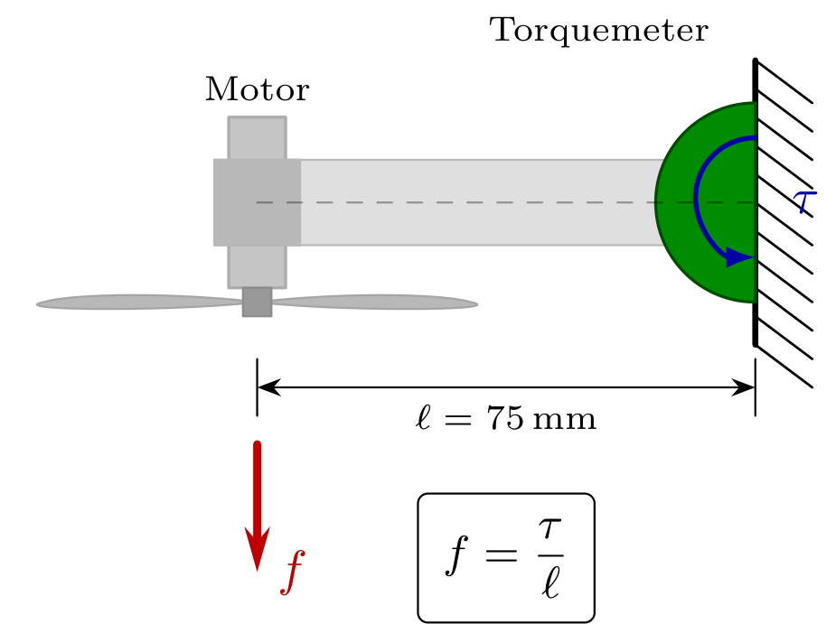
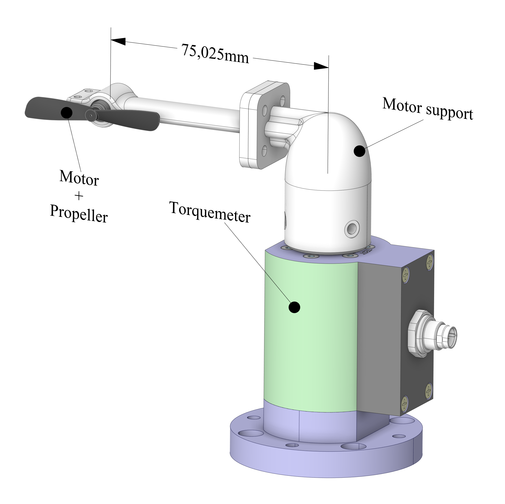
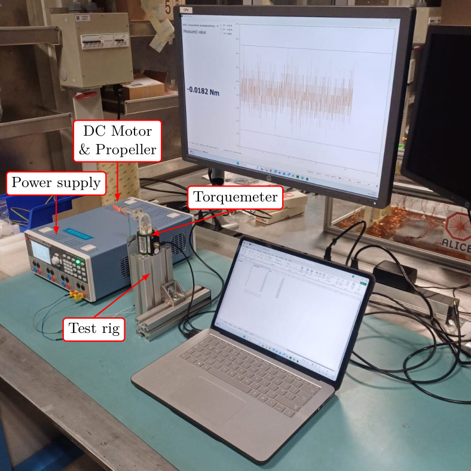
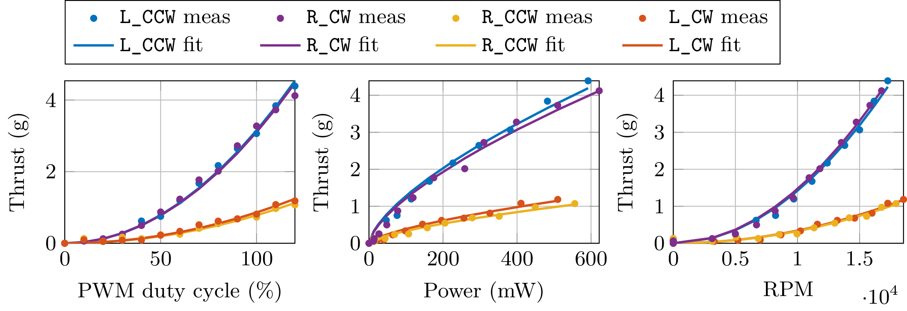

# Propeller_thrust

Thrust characterisation of the **maxon RE 6** brushed DC coreless motor (Ø6 mm, 0.3 W, part no. 386782)
with the **Bitcraze 47-17** propeller, the propulsion unit of the indoor blimp developed at CERN.

## What is measured

The control models of the blimp take a normalised, signed duty-cycle command $D \in [-1, 1]$ as input.
From momentum theory ($f = k_T\,\omega^2$) and the linear speed–voltage law of a brushed DC motor
($\omega \approx k_v V_{\text{supply}} D$), the thrust of a single unit is

$$f_{\text{single}} = k_f\, D\,|D|, \qquad k_f = k_T\, k_v^2\, V_{\text{supply}}^2 .$$

The test identifies the thrust gain $k_f$ and checks that the quadratic law holds.

**Configurations.** Two blade geometries (L: designed for CCW rotation, R: designed for CW rotation) ×
two rotation directions = 4 configurations, `L_CCW`, `L_CW`, `R_CCW`, `R_CW`, each repeated 3 times.

**Test bench.** The motor is mounted at the tip of a rigid arm of length $\ell = 75$ mm; a Burster 8625
torque sensor records the reaction torque $\tau$, and thrust is $f = \tau/\ell$ (reported in gram-force).
The motor is driven directly by an R&S HMP4040 power supply at 0–6 V in 0.5 V steps (13 points),
reported as $D = V / 5\,\text{V}$, i.e. $D \in \{0, 0.1, \dots, 1.2\}$. Current and RPM are logged at
each point. The zero-voltage offset is subtracted before the analysis.

| Measurement principle | CAD of the bench |
|:---:|:---:|
|  |  |

<p align="center">
  
</p>

## Results

The mean thrust over the three repetitions is fitted with $\hat f(D) = k_f D^2$ (through the origin).
Values at the nominal operating point $D = 1$, mean ± standard deviation over the 3 repetitions:

| Configuration | $k_f$ (g) | $R^2$ | Thrust (g) | Power (mW) | Efficiency (g/W) |
|---|---|---|---|---|---|
| `L_CCW` | 3.151 ± 0.042 | 0.996 | 3.06 ± 0.14 | 381.7 | 8.03 |
| `L_CW`  | 0.861 ± 0.008 | 0.984 | 0.81 ± 0.07 | 326.7 | 2.49 |
| `R_CCW` | 0.783 ± 0.048 | 0.973 | 0.73 ± 0.09 | 351.7 | 2.08 |
| `R_CW`  | 3.106 ± 0.098 | 0.989 | 3.27 ± 0.10 | 398.3 | 8.22 |

- The quadratic law fits all configurations with $R^2 \geq 0.97$; $k_f$ is repeatable within 1–6 %.
- Blades spinning in their design direction (`L_CCW`, `R_CW`) give about 4× more thrust than the
  mismatched ones: $k_f^{+} \approx 3.13$ g against $k_f^{-} \approx 0.82$ g.
- The flight controller therefore uses two gains, $k_f^{+}$ for $D \geq 0$ and $k_f^{-}$ for $D < 0$,
  and scales reverse commands by $\sqrt{k_f^{+}/k_f^{-}} \approx 1.95$ (compensation factor $C_f = 2.0$).



*Measured thrust vs PWM duty cycle, input power and RPM. Points: mean over 3 repetitions; solid lines:
fits $k_f D^2$, $c\,P^{2/3}$ and $k_n n^2$.*

## Repository layout

| Path | Content |
|---|---|
| `maxon.m` | Analysis script: loads the data, removes the offset, fits $k_f D^2$ (per repetition and on the mean), $c\,P^{2/3}$ vs power and $k_n n^2$ vs RPM, plots everything and exports the data for the thesis figures to `tikz_data/`. |
| `data/` | Raw data: 12 folders `new_<config>_<rep>/`, each with 13 DigiVision exports `new_<config>_<rep>_<VV>.xlsx`, one per supply voltage (`VV` = 00, 05, …, 60 → 0.0–6.0 V). The torque samples are in sheet `Data`, column C. |
| `prop_rpm_data.xlsx` | Current (mA) and RPM at each voltage step, one sheet per run. The `old_A_*` / `old_B_*` sheets are from earlier tests whose raw data are not included. |
| `tikz_data/` | Output of `maxon.m` used by the thesis figures: `thrust_vs_pwm.dat`, `thrust_vs_power.dat`, `thrust_vs_rpm.dat`. |
| `figures/` | Figures as PNG, their sources copied from the thesis (standalone LaTeX/TikZ `.tex`), the bench photo used by `test_setup_thrust.tex` and the CAD render. |
| `Photos/` | Photos of the test bench (26/03/2025): `test_bench_overview.jpg` (wide view of the bench), `test_bench_front.jpg` and `test_bench_front_hires.jpg` (cropped front view, normal and high resolution). |

## How to reproduce

1. **Analysis (MATLAB):** open MATLAB in the repository root and run `maxon.m`. It reads `data/` and
   `prop_rpm_data.xlsx`, prints the fit results and rewrites the three files in `tikz_data/`.
2. **Figures (LaTeX):** compile from inside `figures/`, e.g.
   ```
   cd figures
   pdflatex thrust_characterization.tex
   ```
   `thrust_characterization.tex` reads the data directly from `../tikz_data/`, so it always shows the
   latest output of `maxon.m`. Requires `pgfplots` (≥ 1.18).

In the thesis the same files live in `Figures/Tikz/chapter_mission/` and `Figures/Data/chapter_mission/`;
the only change in the copies here is the relative paths.
